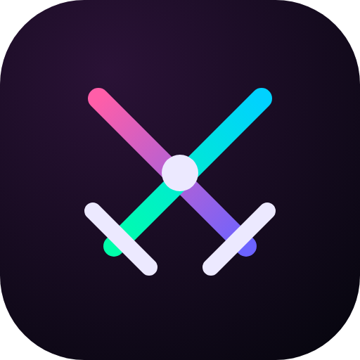
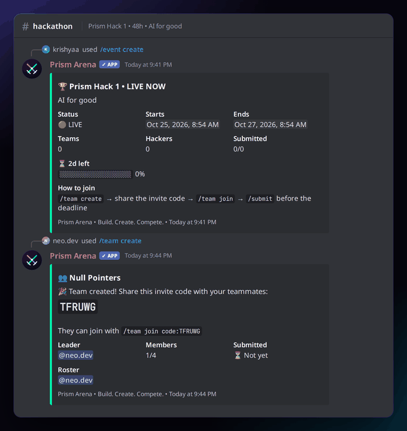
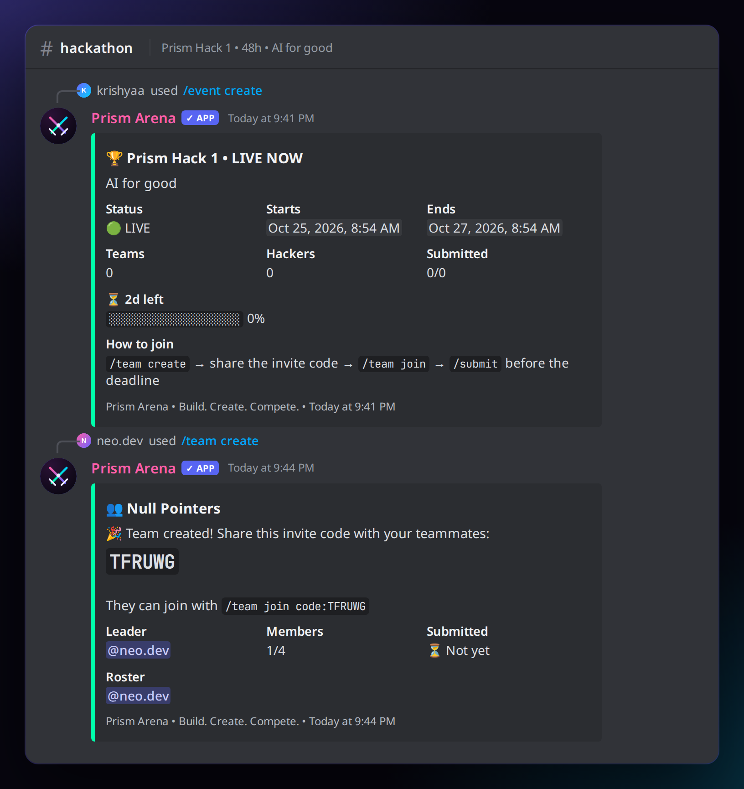
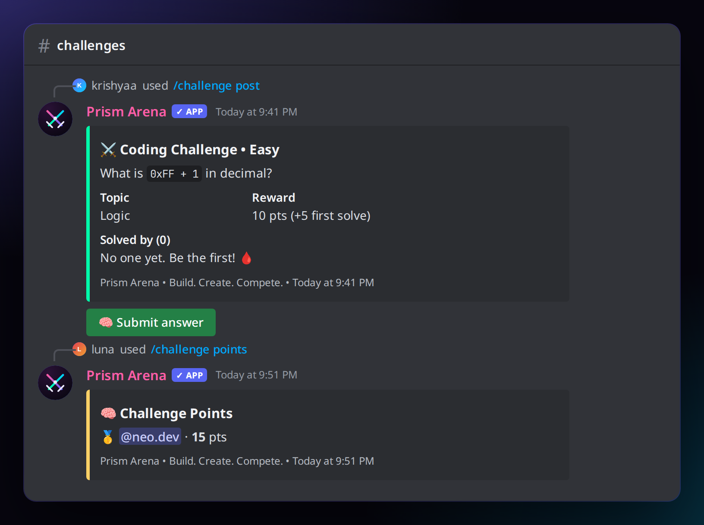
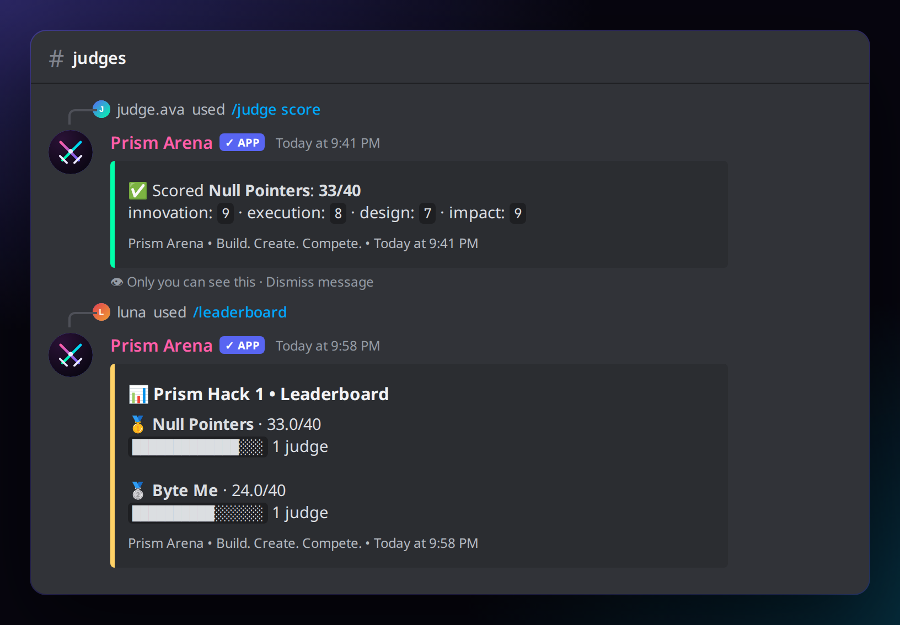
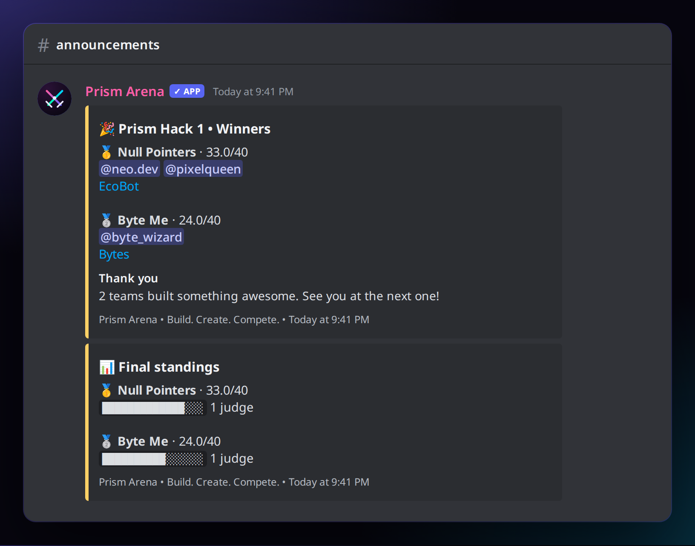
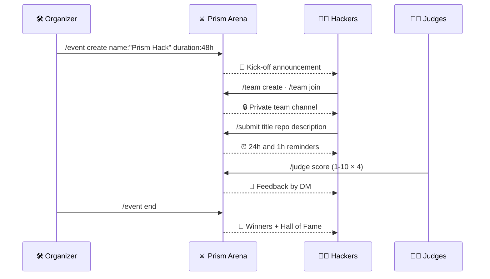

<!-- ═════════════ HEADER ═════════════ -->
<p align="center">
  
</p>

<p align="center">
  
</p>

<p align="center">
  
</p>

<p align="center">
  
  
  
  <a href="LICENSE"></a>
  
</p>

<p align="center">
  
</p>


## ⚡ Overview

**Prism Arena** turns any Discord server into a hackathon venue.
Organizers create an event, hackers form teams with invite codes, submit their projects with a slash command, judges score them on four criteria and a **live leaderboard** updates instantly. When time is up, the bot announces the podium automatically.

Between hackathons, keep the community sharp with **coding challenges**: post a question, members answer through a private pop-up, and the first correct answer earns a 🩸 **first-blood bonus**.

> Built for the [Prism Protocol](https://dc.gg/prismprotocol) community motto: **Build. Create. Compete.**

## 📸 Screenshots

<table>
  <tr>
    <td width="50%"><p align="center"><b>/event create</b> + <b>/team create</b></p></td>
    <td width="50%"><p align="center"><b>/challenge post</b> · answer with a button</p></td>
  </tr>
  <tr>
    <td width="50%"><p align="center"><b>/judge score</b> → <b>/leaderboard</b></p></td>
    <td width="50%"><p align="center">Automatic winners announcement</p></td>
  </tr>
</table>

## ✨ Features

| | Feature | Details |
|---|---------|---------|
| 🏆 | **Events** | Name, theme, duration (`24h`, `48h`, `1w`), delayed start, max team size, deadline extension, live progress bar |
| 👥 | **Teams** | 6-character invite codes, leader hand-over on leave, optional **private team channels** visible to members and judges |
| 📦 | **Submissions** | Title, repo, description and demo link. Teams can update until the deadline; URLs are validated |
| 🧑‍⚖️ | **Judging** | Innovation, Execution, Design and Impact (1 to 10 each). Personal judge queue, re-scoring, private feedback sent to the team by DM |
| 📊 | **Leaderboard** | Average score across judges with progress bars, ties broken by submission time |
| ⏰ | **Reminders** | Kick-off, 24 hours left, 1 hour left and "submissions closed" posts in your announcements channel |
| 🎉 | **Winners** | 🥇🥈🥉 podium with members and project links, saved to a **Hall of Fame** |
| 🧠 | **Challenges** | 15 built-in questions (Easy / Medium / Hard), answers via modal, 10 pts + 5 first-blood bonus, points leaderboard |
| 🔐 | **Roles** | Organizer and judge roles (admins always allowed), friendly error messages for everyone else |

## 🧩 Commands

| Command | Who | Description |
|---------|:---:|-------------|
| `/help` | Everyone | How Prism Arena works |
| `/event create name duration [starts_in] [max_team_size] [description]` | Organizer | Create a new hackathon |
| `/event info` | Everyone | Timer, stats and how to join |
| `/event extend by` | Organizer | Extend the deadline (e.g. `30m`, `2h`) |
| `/event end` | Organizer | Close the event and announce winners |
| `/team create name` | Hacker | Create a team and get an invite code |
| `/team join code` | Hacker | Join a team |
| `/team leave` | Hacker | Leave your team |
| `/team info [name]` | Everyone | Show a team (autocomplete) |
| `/team list` | Everyone | All teams with submission status |
| `/submit title repo description [demo]` | Hacker | Submit or update your project |
| `/judge score team innovation execution design impact [feedback]` | Judge | Score a team (autocomplete) |
| `/judge queue` | Judge | Projects you have not scored yet |
| `/leaderboard` | Everyone | Live standings |
| `/challenge post [level]` | Organizer | Post a coding challenge |
| `/challenge points` | Everyone | Challenge points leaderboard |
| `/arena config [announcements] [judge_role] [organizer_role] [team_category]` | Admin | Configure channels and roles |
| `/arena view` | Admin | Show the configuration |
| `/arena history` | Admin | Past events and winners |

## 🔄 How a hackathon flows



## 🚀 Getting Started

### 1. Create the bot

1. Open the [Discord Developer Portal](https://discord.com/developers/applications) → **New Application**
2. **Bot** tab → **Reset Token** → copy it
3. **No privileged intents are needed.** Prism Arena only uses the `Guilds` intent
4. Copy the **Application ID** from **General Information**

### 2. Install

```bash
git clone https://github.com/krishyaa06/prism-arena.git
cd prism-arena
npm install
cp .env.example .env      # paste your token and application ID
```

| Variable | Required | Description |
|----------|:--------:|-------------|
| `DISCORD_TOKEN` | ✅ | Bot token |
| `CLIENT_ID` | ✅ | Application ID |
| `GUILD_ID` | | Register commands instantly in one server while developing |
| `EMBED_COLOR` | | Brand colour in hex, default `00FFAA` |
| `ARENA_DATA_DIR` | | Where JSON data is stored, default `./data` |

### 3. Invite

```
https://discord.com/oauth2/authorize?client_id=YOUR_CLIENT_ID&permissions=268520464&scope=bot%20applications.commands
```

Permissions: View Channels, Send Messages, Embed Links, Read Message History, Manage Channels and Manage Roles (the last two are only used for private team channels).

### 4. Run

```bash
npm run check     # validate every command offline
npm run deploy    # register slash commands
npm start
```

Then run `/arena config announcements:#hackathon judge_role:@Judges organizer_role:@Organizers` and you are ready for `/event create`.

## 🧮 Scoring

Each judge gives 1 to 10 points for **Innovation, Execution, Design and Impact** (max 40).
A team's score is the **average total across all judges who scored it**, so a team is never penalised because fewer judges reached it. Ties go to the team that submitted first.

## 📁 Project Structure

```
prism-arena/
├── src/
│   ├── commands/         # arena, challenge, event, help, judge, leaderboard, submit, team
│   ├── events/           # ready (starts scheduler), interactionCreate (commands, buttons, modals, autocomplete)
│   ├── lib/
│   │   ├── arena.js      # pure game logic: events, teams, scores, leaderboard
│   │   ├── challenges.js # question bank
│   │   ├── scheduler.js  # reminders + auto close
│   │   ├── announce.js   # announcement channel helper
│   │   ├── perms.js      # organizer / judge checks
│   │   └── db.js · embeds.js · loader.js · logger.js
│   ├── config.js
│   ├── deploy-commands.js
│   └── index.js
├── scripts/check.js
├── test/arena.test.js
└── assets/
```

## 🧪 Testing

```bash
npm test         # event lifecycle, teams, submissions, scoring, leaderboard, challenges
npm run check    # loads every command without logging in
```

The core logic in `src/lib/arena.js` has no Discord dependency, so it is easy to test and extend.

## 🗺️ Roadmap

- [x] Events, teams, submissions, judging, leaderboard
- [x] Reminders and automatic winners
- [x] Coding challenges with first-blood bonus
- [ ] Custom judging criteria per event
- [ ] Import challenges from JSON / Codeforces
- [ ] Export results to CSV
- [ ] Web dashboard for organizers

## 🤝 Contributing

1. Fork the repo
2. Create a branch: `git checkout -b feature/amazing-idea`
3. Run `npm test && npm run check`
4. Open a Pull Request

Want more challenges? Add them to `src/lib/challenges.js`. PRs with new questions are very welcome.

## 👤 Author

<table>
  <tr>
    <td align="center">
      <a href="https://github.com/krishyaa06"><br><b>Soumya Bhandare</b></a><br>
      <sub>Founder @ Prism Protocol</sub>
    </td>
    <td>
      <a href="https://dc.gg/prismprotocol"></a><br>
      <a href="https://instagram.com/prism_protocol_"></a><br>
      <a href="https://x.com/krishyaa06"></a>
    </td>
  </tr>
</table>

## 📄 License

Released under the [MIT License](LICENSE).

<p align="center">
  <b>If you like this project, consider giving it a ⭐</b><br>
  <sub>"Build. Create. Compete." · Made with ⚡ by Prism Protocol</sub>
</p>


